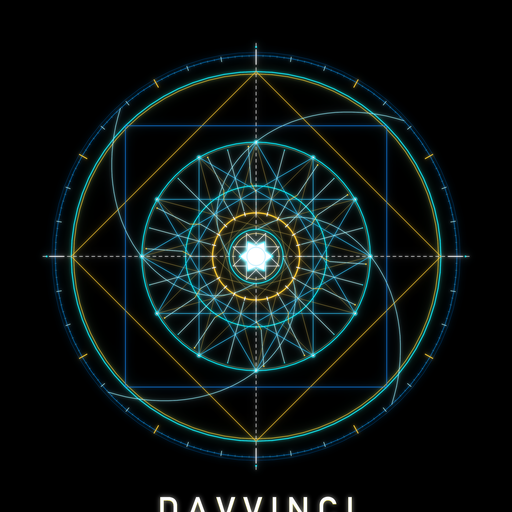

<p align="center"></p>

<h1 align="center">DAVVINCI CORE</h1>

<p align="center">
  <b>Tu biblioteca de PS5, en un solo lugar.</b><br>
  Motor FPKG nativo · Instalador de discos externos · Diagnóstico en vivo
</p>

<p align="center">
  <a href="https://github.com/B4ckd0orl/davinci-core/releases/download/v1.0.0/Davinci-Core-v1.0.elf"></a>
  <a href="https://t.me/padrinostores"></a>
  <a href="https://github.com/B4ckd0orl/davinci-core/actions"></a>
</p>

---

## ⬇️ Descarga directa

### [⬇️ Descargar `Davinci-Core-v1.0.elf`](https://github.com/B4ckd0orl/davinci-core/releases/download/v1.0.0/Davinci-Core-v1.0.elf)

**Versión 1.0** · Archivo: `Davinci-Core-v1.0.elf` · [SHA256SUMS](https://github.com/B4ckd0orl/davinci-core/releases/download/v1.0.0/SHA256SUMS)

**En español**

1. Pulsa **Descargar `Davinci-Core-v1.0.elf`**.
2. O abre la [página del lanzamiento](https://github.com/B4ckd0orl/davinci-core/releases/tag/v1.0.0) → **Assets** → `Davinci-Core-v1.0.elf`.
3. Solo necesitas el **`.elf`**. Los **Source code (zip)** son para desarrolladores: no los descomprimas.
4. Envíalo a tu PS5 con tu cargador de ELF habitual y abre `http://<IP-PS5>:8097`.

<details>
<summary><b>English</b></summary>

1. Click **Download `Davinci-Core-v1.0.elf`** above.
2. Or open the [release page](https://github.com/B4ckd0orl/davinci-core/releases/tag/v1.0.0) → **Assets** → `Davinci-Core-v1.0.elf`.
3. You only need the **`.elf`**. **Source code (zip)** downloads are for developers.
4. Send it to your PS5 with your usual ELF loader, then open `http://<PS5-IP>:8097`.

</details>

---

## ⚙️ Antes de cargarlo

**DAVVINCI CORE incluye kstuff-lite y ShadowMountPlus y los arranca solo.**

- Si usabas **kstuff o ShadowMount independientes**, quítalos de tu **autoload / Payload Manager** y carga **solo DAVVINCI CORE**.
- No borres el jailbreak ni elfldr: solo elimina esas entradas de lanzamiento duplicadas.
- Cierra los juegos y reinicia la consola si esos servicios ya estaban corriendo.
- No incluye el exploit de jailbreak: sigue necesitando el tuyo.

---

## ✨ Qué hace

| | |
|---|---|
| 🎮 **Panel + Biblioteca** | FPKG de depuración, carpetas, imágenes y exFAT, con carátulas |
| 📦 **Instalador** | USB o disco externo, progreso, verificación byte a byte y cancelación |
| 💾 **Respeta tus archivos** | El PKG original nunca se mueve ni se borra, ni en el mismo disco |
| 📊 **Diagnóstico en vivo** | CPU, memoria, almacenamiento, logs del kernel y alertas |
| 📤 **Informes** | Exportación JSON/CSV e impresión / guardar como PDF |
| 🌍 **31 idiomas** | Árabe RTL, temas y navegación cómoda con mando |


*Interfaz con datos sintéticos. Los sensores no soportados siguen sin datos en la consola real.*

---

## 🚀 Uso rápido

1. **Cierra** los juegos.
2. **Envía** el ELF a tu PS5.
3. **Abre** `http://<IP-PS5>:8097` desde la consola o desde tu PC/móvil.
4. **Instala** un FPKG desde la Biblioteca o el Instalador.

> **Límites conocidos:** el tamaño completo de paquetes externos en el almacenamiento del sistema de la PS5 no está verificado; temperatura/GPU/tasa de E/S no las expone este backend; el instalador USB no reanuda tras cortes de energía ni fusiona actualizaciones/DLC. La versión 1.0 no implica compatibilidad universal con firmas o juegos.

---

## 🛠 Compilar

```sh
DAVINCI_UNIFIED_STACK=1 bash ps5/build.sh
```

Rust 1.99.0 + PS5 payload SDK 0.43 en Docker, 2 trabajos de compilador como máximo. Salida: `target/ps5/davinci-core.elf`. Arquitectura en [DESIGN.md](DESIGN.md) · validación en [docs/](docs/) · cambios en [RELEASE-NOTES.md](RELEASE-NOTES.md).

| Capa | Implementación |
|---|---|
| Backend de consola | Rust: paquetes, caché, registro, montaje, instalador y HTTP |
| Integración PS5 | C y Assembly: shims, arranque y enlazado |
| Interfaz web | HTML/CSS/JS: biblioteca, ajustes, idiomas y diagnóstico |
| Build | Shell, Dockerfile y Python |

---

## 💜 Soporte

**Dudas, reportes y comunidad → [t.me/padrinostores](https://t.me/padrinostores)**

**Donaciones USDT (TRC20 · Bybit):** `TVznmcju7ckrJZ3obCRv5SsMGrLRVY2SQF`

<p align="center">
  <a href="https://t.me/padrinostores"></a>
</p>
