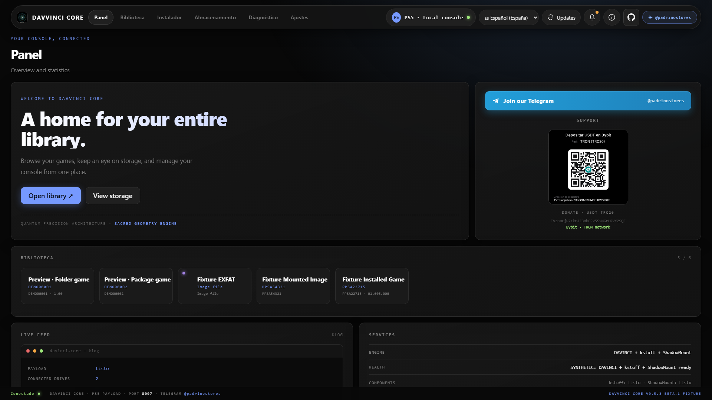

<p align="center"></p>
<h1 align="center">DAVVINCI CORE</h1>
<p align="center">Un espacio de trabajo para juegos de PS5 con motor FPKG nativo, instalador de discos externos y diagnóstico en vivo.</p>

## Versión 1.0

Los PKG instalados internamente permanecen en su ruta del sistema. La instalación externa conserva tu archivo original, crea la carpeta del juego automáticamente y muestra el tamaño del paquete externo instalado por separado de la caché interna. Conectar un disco USB no monta automáticamente los PKG de instalación en bruto. El runtime de juegos incluido muestra **PLAY NO LIMIT**.

**Limitación conocida:** el tamaño completo del paquete externo dentro del almacenamiento del sistema de la PS5 no está verificado. El número de versión 1.0 no implica compatibilidad universal con firmas/juegos ni una nueva validación completa de hardware. Consulta la [validación del lanzamiento](docs/V1_0_VALIDATION.md).

## ⬇️ Descargar DAVVINCI CORE

### [⬇️ Descargar el archivo ELF directamente](https://github.com/B4ckd0orl/davinci-core/releases/download/v1.0.0/Davinci-Core-v1.0.elf)

**Versión / Version: 1.0** · **Archivo / File: `Davinci-Core-v1.0.elf`**

**En español**

1. Pulsa el enlace **Descargar el archivo ELF directamente** de arriba para descargar el payload.
2. Si abres la [página del lanzamiento](https://github.com/B4ckd0orl/davinci-core/releases/tag/v1.0.0), despliega **Assets** y pulsa **`Davinci-Core-v1.0.elf`**.
3. El archivo necesario para ejecutarlo es el **`.elf`**. Las descargas **Source code (zip / tar.gz)** son para desarrolladores, no son el payload. No necesitas descomprimir el ELF.
4. Envía el ELF a tu PS5 con tu cargador de payloads/elfldr habitual y luego abre `http://<IP-PS5>:8097` sustituyendo `<IP-PS5>` por la dirección de tu consola.

**English**

1. Click **Download ELF directly** above to download the runnable payload.
2. If you open the [release page](https://github.com/B4ckd0orl/davinci-core/releases/tag/v1.0.0), expand **Assets** and select **`Davinci-Core-v1.0.elf`**.
3. You need the **`.elf`** file to run DAVVINCI CORE. **Source code (zip / tar.gz)** downloads are for developers. The ELF does not need extraction.
4. Send the ELF to your PS5 using your existing payload/elfldr loader, then open `http://<PS5-IP>:8097`, replacing `<PS5-IP>` with your console's address.

[Todos los lanzamientos / All releases](https://github.com/B4ckd0orl/davinci-core/releases) · [SHA256SUMS](https://github.com/B4ckd0orl/davinci-core/releases/download/v1.0.0/SHA256SUMS)

## ⚙️ Antes de cargar DAVVINCI CORE

**DAVVINCI CORE incluye kstuff-lite y ShadowMountPlus y los inicia automáticamente.**

- Si usabas **kstuff o ShadowMount como payloads independientes**, desactiva su carga automática o elimínalos de tu lista de **autoload / Payload Manager**. Carga **solo DAVVINCI CORE** en lugar de los tres por separado.
- Lo que hay que quitar son las **entradas de lanzamiento separadas**; no necesitas borrar el jailbreak, elfldr ni los archivos de los juegos. Mantén intactos los componentes incluidos en DAVVINCI CORE.
- Si los servicios independientes ya están en ejecución, cierra los juegos y reinicia la consola para empezar una sesión nueva. Aplica tu jailbreak habitual, deja elfldr disponible y carga el ELF de DAVVINCI CORE una sola vez.
- DAVVINCI CORE no incluye el exploit de jailbreak: sigue necesitando tu jailbreak y tu cargador de ELF habitual. Comprueba el estado de los servicios en Panel y Diagnóstico.

[LANZAMIENTOS](https://github.com/B4ckd0orl/davinci-core/releases) · [CÓDIGO](https://github.com/B4ckd0orl/davinci-core) · [TELEGRAM](https://t.me/padrinostores)

## Actualizaciones y gestión de juegos instalados

La cabecera muestra el estado de actualización junto al selector de idioma. Compara hasta 100 lanzamientos públicos recientes del repositorio oficial, compara versiones semánticas (incluidas las beta), ignora borradores/no publicados y exige un ELF subido con una URL de descarga oficial del repositorio. Las comprobaciones automáticas se ejecutan tras identificar la consola y como máximo una vez cada 30 minutos por sesión de página, con opción de reintento manual. Los fallos de red/límite de peticiones se distinguen de una comprobación exitosa que no encuentra versiones más recientes. La descarga sigue siendo una acción del usuario: no se carga ni reemplaza ningún payload automáticamente. Comprobar requiere acceso del navegador a GitHub. Los lanzamientos públicos actuales pueden ir por detrás de las compilaciones locales.

**Gestionar juego instalado** abre el panel propio de DAVVINCI CORE: conserva los detalles del paquete y la caché, pone en cola un reescaneo de la biblioteca, mantiene la acción existente de reconstrucción de caché y navega a Diagnóstico. La gestión de juegos instalados ya no abre la interfaz web de ShadowMount. La guía de desinstalación apunta a Ajustes de PS5; no se introdujo ninguna API nueva de borrado de juegos. Las herramientas solo de imagen conservan su comportamiento actual. La reconstrucción queda desactivada mientras hay un juego en ejecución. Una comprobación correcta de montaje/propiedad de la ruta limpia ahora un error anterior obsoleto.

## Preparar los PKG instalados en su ubicación original

Con **Preparar PKG instalados en su lugar automáticamente** activado, DAVVINCI CORE descubre los FPKG de depuración válidos bajo `/user/app/<TITLE_ID>/app.pkg` y construye su caché nativa de arranque sin mover el paquete a homebrew. El acceso de lectura se prepara para el montaje de solo lectura del sandbox del juego; los permisos originales se registran primero. El paquete sigue siendo un único archivo físico en la ubicación del sistema.

Los paquetes internos con recibo movidos por versiones anteriores de DAVVINCI CORE pueden devolverse a su ruta original de instalación. El título del paquete y el tamaño registrado deben coincidir. Si ya existe un `app.pkg` distinto, se rechaza. La restauración registra en diario y reserva en exclusiva el destino ausente, verifica esa reserva y luego usa rename con un alias verificado de `/user/data` cuando hace falta; no hay copia completa de respaldo. No instales, actualices ni desinstales el mismo título a la vez: el SDK no expone una operación rename atómica sin reemplazo. Un directorio de título ausente puede recrearse con los metadatos de registro en caché coincidentes. Las restauraciones no soportadas dejan intacto la fuente gestionada anterior. Los paquetes relocados manualmente sin un recibo válido no se mueven automáticamente.

Esta restauración verificada basada en rename sustituye al enlace duro anterior no soportado y conserva la corrección grande de metadatos. La caché sigue ocupando almacenamiento adicional. El mantenedor confirmó el arranque en la ruta original y los tamaños internos completos del almacenamiento del sistema en la consola de desarrollo; los cambios posteriores de instalador/interfaz tienen pruebas locales y requieren sus comprobaciones de hardware documentadas. Usa el motor nativo de caché/montaje para los FPKG de depuración soportados.

## Características

- Panel y biblioteca de juegos para FPKG de depuración soportados, carpetas y fuentes de imagen, incluido exFAT.
- Navegador de USB/discos ampliados, destino FPKG interno o externo conectado, progreso, verificación byte a byte y cancelación.
- **Preparación en la ruta original para instalaciones de Debug Settings/Overdrive soportadas:** mantiene `app.pkg` bajo `/user/app/<TITLE_ID>/`, con recuperación verificada de importaciones internas anteriores.
- CPU y memoria reportadas del sistema/payload, almacenamiento, registros en vivo, visor de registro del kernel y alertas actuales.
- Historial de CPU local en el navegador, comprobaciones de salud de solo lectura, exportaciones JSON/CSV e informes de impresión/guardado como PDF.
- 31 opciones de idioma/región de consola, indicadores de bandera, árabe RTL, temas y navegación cómoda con mando.


*Vista previa de la interfaz con datos sintéticos. Los sensores no soportados siguen no disponibles en la consola real.*

## Uso

1. Cierra los juegos antes de cargar un payload nuevo.
2. Envía el ELF del lanzamiento con tu flujo de elfldr habitual.
3. Abre `http://<IP-PS5>:8097` desde la consola o desde un navegador de tu Mac/PC/móvil.
4. Explora la Biblioteca o abre el Instalador para elegir un FPKG de depuración de PS5 soportado desde un USB/disco ampliado montado.

El Instalador copia el PKG al destino interno o externo elegido y conserva el original, incluso en el mismo disco externo. La instalación externa crea `DAVINCI-CORE/Games/<TITLE_ID>/` automáticamente. Los PKG externos en bruto siguen siendo solo del Instalador hasta que se instalan. El motor nativo construye después su caché, registra el juego y monta su contenido al arrancar. Este es el flujo homebrew/FPKG de depuración, no un instalador general de PKG retail/cifrados. La caché ocupa espacio extra y puede ser considerable en diseños de bloques incompatibles. Los paquetes instalados soportados se preparan en su ruta original del sistema. La recuperación antigua rechaza colisiones y movimientos de mismo inodero no disponibles, dejando intacta la fuente gestionada sin crear otro paquete completo.

No desconectes la unidad de origen durante la instalación. Las cancelaciones/errores normales limpian la copia parcial de la transacción; un corte de energía puede dejar un directorio `.part` reservado que hay que inspeccionar antes de reintentar. No están implementados la reanudación ni la fusión de actualizaciones/DLC.

## Diagnóstico y localización

Las métricas las reporta la consola, con alternativas solo del payload etiquetadas explícitamente. La temperatura/GPU/tasa de E/S no las expone este backend y siguen desconocidas. El historial de CPU empieza al abrir la página; no es telemetría histórica de la consola. Las comprobaciones de diagnóstico inspeccionan solo el estado reportado y no son pruebas de estrés de hardware. Los informes e historial se gestionan en el navegador.

Inglés, español, francés, árabe, chino simplificado y alemán tienen catálogos completos actuales. Los demás idiomas traducen ahora mismo 50 etiquetas centrales y usan el texto técnico en inglés como respaldo. Consulta la [cobertura](Localizations/coverage.json).

## Tecnología

[](https://github.com/B4ckd0orl/davinci-core/search?l=rust) [](https://github.com/B4ckd0orl/davinci-core/search?l=html) [](https://github.com/B4ckd0orl/davinci-core/tree/main/ps5/shim) [](https://github.com/B4ckd0orl/davinci-core/tree/main/ps5) [](https://github.com/B4ckd0orl/davinci-core/tree/main/ps5) [](https://github.com/B4ckd0orl/davinci-core/blob/main/ps5/Dockerfile) [](https://github.com/B4ckd0orl/davinci-core/tree/main/review)

| Capa | Implementación |
|---|---|
| Backend de consola | Rust: descubrimiento de paquetes, caché, registro, montaje, instalador y servicio HTTP |
| Integración con la consola | C y Assembly: shims de PS5, arranque y soporte de enlazado |
| Interfaz de navegador | HTML, CSS y JavaScript: biblioteca, ajustes, localización y diagnóstico |
| Build y herramientas | Shell, Dockerfile y Python: builds del payload, incrustación de la UI y herramientas de revisión |

Los porcentajes de lenguaje de GitHub miden bytes de código clasificados; no miden esfuerzo de ingeniería ni propiedad. Consulta el panel Languages del repositorio para su cálculo actual.

## Compilar

El código usa Rust 1.99.0 y el PS5 payload SDK 0.43 dentro de la build de Docker. Mantén la paralelización del compilador en dos trabajos.

```sh
DAVINCI_UNIFIED_STACK=1 bash ps5/build.sh
```

La build verifica los hashes del runtime/servicios incluidos y compila las dos etapas del ELF. Los paquetes son `davinci-core` y `crates/davinci-core-pkg`; la imagen de toolchain Docker es `davinci-core-ps5` y la salida es `target/ps5/davinci-core.elf`. Los nombres de archivo del protocolo del runtime siguen siendo compatibles con el upstream. Consulta la [arquitectura](DESIGN.md) y la [validación](docs/VALIDATION.md).

## Soporte

Dudas, reportes y comunidad: [t.me/padrinostores](https://t.me/padrinostores).

Si quieres apoyar el proyecto puedes donar USDT (TRC20, Bybit): `TVznmcju7ckrJZ3obCRv5SsMGrLRVY2SQF`.

## Destino externo de instalación

En el Instalador, elige Interno o un destino USB/disco ampliado conectado antes de seleccionar un PKG. DAVVINCI crea `<disco>/DAVINCI-CORE/Games/<TITLE_ID>/` automáticamente. La instalación conserva siempre la descarga original y verifica una copia instalada separada, incluso en el mismo disco externo. Deja espacio para la copia completa más la reserva de trabajo. Los PKG del sistema ya instalados permanecen en su sitio.

Mantén el destino conectado mientras juegas. La caché nativa sigue ocupando almacenamiento interno y puede ser considerable. El tamaño de la fuente externa en DAVVINCI no es una garantía de la contabilidad completa del almacenamiento del sistema de la PS5. El mantenedor reporta un uso correcto de la ruta externa gestionada en la consola de desarrollo; la compatibilidad con hardware más amplio y la contabilidad completa del almacenamiento externo de la PS5 siguen sin verificar. Consulta la [validación](docs/EXTERNAL_DESTINATION_VALIDATION.md).

## Historial de versiones

El cambio detallado de cada versión está en [RELEASE-NOTES.md](RELEASE-NOTES.md) y las comprobaciones de hardware en [docs/](docs/).

## Límites conocidos

- Los idiomas adicionales están parciales; inglés, español, francés, árabe, chino simplificado y alemán están completos.
- Las mediciones de temperatura/GPU/tasa de E/S no soportadas siguen desconocidas.
- El historial de gráficos empieza al abrir la página.
- Las comprobaciones de salud inspeccionan solo los datos reportados.
- El instalador USB no tiene reanudación ante cortes de energía ni fusión de actualizaciones/DLC.

Los snapshots privados de la consola, rutas personales de sistema y logs del propietario están excluidos del repositorio público.
